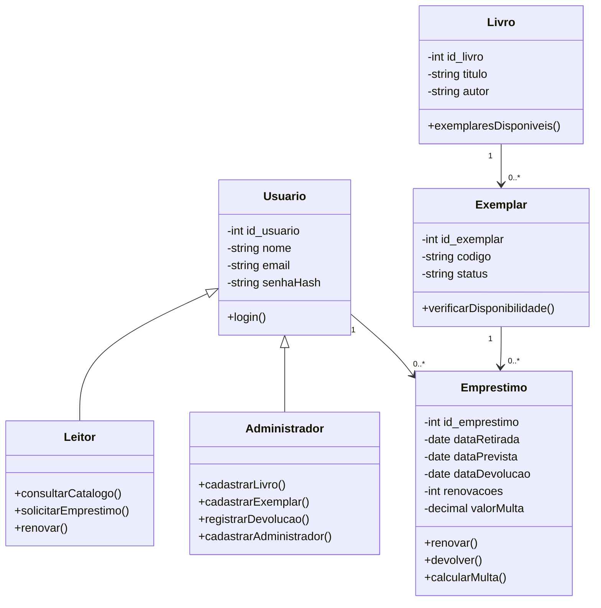

# Biblioteca – API de gerenciamento de empréstimos

API REST em Node.js para gerenciar o acervo e os empréstimos de uma biblioteca. Projeto do Desafio Back-end 2026/2 (Comp Júnior), feito por **Pedro Matos**.

## Sumário

1. [Tema e propósito](#1-tema-e-propósito)
2. [Tecnologias](#2-tecnologias)
3. [Como executar](#3-como-executar)
4. [Modelagem (DER)](#4-modelagem-der)
5. [Regras de negócio e permissões](#5-regras-de-negócio-e-permissões)
6. [Endpoints](#6-endpoints)
7. [Integração externa: Open Library](#7-integração-externa-open-library)
8. [Collection do Postman](#8-collection-do-postman)
9. [Arquitetura e tratamento de erros](#9-arquitetura-e-tratamento-de-erros)
10. [Decisões de CRUD e limitações](#10-decisões-de-crud-e-limitações)

---

## 1. Tema e propósito

Categoria: **sistema de gerenciamento** (biblioteca).

Escolhi fazer um sistema de biblioteca porque é um tema que me chama atenção e que eu já queria ter feito antes em C++. Me inspirei no sistema de biblioteca que a UFLA utiliza, e minha ideia foi construir uma versão simplificada das funções principais desse tipo de sistema, pensada para a biblioteca de uma universidade.

O sistema tem dois tipos de usuário. O leitor (aluno) consulta o catálogo, vê se o livro está disponível, pega livros emprestados, renova e acompanha seus prazos. O administrador (bibliotecário) cadastra os livros e exemplares, controla o acervo e registra as devoluções. Se um livro é devolvido depois do prazo, o sistema calcula uma multa pelos dias de atraso.

## 2. Tecnologias

- Node.js 22, Express 5 e JavaScript
- MySQL 8 com Sequelize (ORM) e migrations/seeders
- JWT (`jsonwebtoken`) e bcrypt (`bcryptjs`)
- Nodemailer (e-mail de recuperação de senha; testado com Mailtrap)
- Open Library API (integração externa)
- Docker e Docker Compose

## 3. Como executar

### Pré-requisitos

- Docker e Docker Compose instalados (no Windows, Docker Desktop aberto)
- Portas **3000** (API) e **3307** (MySQL no computador) livres
- Git

### Passo a passo

1. Clone o repositório:

```bash
git clone https://github.com/PedroMatos-01/biblioteca-back.git
cd biblioteca-back
```

2. (Opcional) Copie o arquivo de variáveis de ambiente. O projeto sobe **sem** ele, usando valores padrão de desenvolvimento. Faça isso apenas se quiser enviar e-mails de verdade ou trocar as chaves:

```bash
cp .env.example .env
```

No Windows (PowerShell): `Copy-Item .env.example .env`

3. Suba a API e o banco:

```bash
docker compose up --build
```

4. Aguarde o log mostrar `server is on in port 3000`. Na primeira vez, a API pode reiniciar algumas vezes enquanto o MySQL inicia; isso é normal.

5. Teste se está no ar: `http://localhost:3000/health`

Ao subir, o Compose cria o banco, aplica as migrations e executa o seeder, que cria o administrador de demonstração:

| Campo | Valor |
|---|---|
| E-mail | `adm@exemplo.com` |
| Senha | `123456` |

Para parar: `docker compose down`. Para apagar também o banco e começar do zero: `docker compose down -v`.

### Variáveis de ambiente (`.env.example`)

| Variável | Para que serve | Padrão se não definida |
|---|---|---|
| `DB_PASSWORD` | senha do MySQL | `root` |
| `JWT_SECRET` | chave que assina o JWT | chave de desenvolvimento |
| `FRONTEND_URL` | origem liberada no CORS e base do link do e-mail | `http://localhost:5173` |
| `MAIL_HOST`, `MAIL_PORT` | servidor SMTP | vazio / `2525` |
| `MAIL_USER`, `MAIL_PASS` | credenciais SMTP | vazio |
| `MAIL_FROM` | remetente do e-mail | `Biblioteca <nao-responda@biblioteca.com>` |

Preencha os dados de e-mail com a caixa de entrada de teste do [Mailtrap](https://mailtrap.io) (SMTP Integration). Nunca coloque credenciais reais no repositório; o `.env` está no `.gitignore`.

### Testando a recuperação de senha

O e-mail só é enviado se `MAIL_*` estiver configurado. Sem isso, o ambiente roda com `DEMO_MODE=true`, que **imprime o token de redefinição no log da API**:

```bash
docker compose logs api
```

Procure a linha `[DEMO] Token de redefinição para ...` e use o token em `POST /auth/redefinir-senha`.

## 4. Modelagem (DER)

Este foi o diagrama de classes da primeira semana. Na implementação ele foi simplificado: `Leitor` e `Administrador` viraram o campo `perfil` da tabela de usuários, e os métodos viraram regras nos services.



Todas as tabelas também têm `created_at` e `updated_at`.

**Entidades e por que existem:**

- **Usuário:** quem acessa o sistema, com perfil de leitor ou administrador.
- **Livro:** o título (autor, ISBN, capa). Uma obra do acervo.
- **Exemplar:** a cópia física de um livro. Separado do livro porque a biblioteca pode ter várias cópias do mesmo título e o empréstimo é de uma cópia específica.
- **Empréstimo:** liga um usuário a um exemplar, com datas, renovações e multa.

## 5. Regras de negócio e permissões

### Regras

- Cada usuário pode ter no máximo **3 empréstimos ativos**.
- Só é possível emprestar exemplar com status `disponivel`; ao emprestar, ele passa a `emprestado`, e na devolução volta a `disponivel`.
- O prazo do empréstimo é de **14 dias**.
- Cada empréstimo pode ser renovado até **3 vezes** (+14 dias cada). Não renova se estiver atrasado ou já devolvido.
- A multa por atraso é de **R$ 1,00 por dia** (qualquer fração de dia conta como um dia), calculada na devolução.
- Criar empréstimo e devolver são operações em **transação**: se qualquer etapa falha, tudo é desfeito.
- Um livro só pode ser excluído se não tiver exemplares. Um exemplar só pode ser excluído se estiver `disponivel`.
- O cadastro público cria sempre usuário com perfil `leitor`. Só o administrador altera perfis.
- E-mail e ISBN são únicos.

### Permissões por perfil

| Recurso / ação | Público | Leitor | Administrador |
|---|:-:|:-:|:-:|
| Cadastrar-se, fazer login, recuperar senha | sim | sim | sim |
| Ver o próprio perfil (`/usuarios/me`) | não | sim | sim |
| Consultar livros e exemplares | não | sim | sim |
| Criar, editar e excluir livros e exemplares | não | não | sim |
| Cadastrar livro por ISBN (API externa) | não | não | sim |
| Criar empréstimo | não | sim | sim |
| Ver e renovar empréstimos | não | só os próprios | todos |
| Registrar devolução | não | não | sim |
| Listar usuários e alterar perfil | não | não | sim |
| Excluir usuário | não | só a própria conta | qualquer |

## 6. Endpoints

URL base: `http://localhost:3000`. As rotas marcadas como **Logado** ou **Admin** exigem o header `Authorization: Bearer <token>`. Os campos com `*` são obrigatórios.

**Formato dos erros:** sempre `{ "erro": "mensagem" }`.

| Código | Quando ocorre |
|---|---|
| 400 | dados faltando ou inválidos |
| 401 | token ausente, inválido ou expirado; login incorreto |
| 403 | perfil sem permissão |
| 404 | recurso ou rota não encontrada |
| 409 | conflito (já existe, indisponível, registros vinculados) |
| 422 | dados incompletos retornados pela API externa |
| 502 | falha ao consultar a API externa |
| 500 | erro interno (sem detalhes na resposta) |

### Tabela de endpoints

| Método | Caminho | Acesso | Corpo (JSON) | Respostas |
|---|---|---|---|---|
| GET | `/health` | Público | – | 200 |
| POST | `/usuarios` | Público | `nome*`, `email*`, `senha*` (mín. 6) | 201, 400, 409 |
| POST | `/auth` | Público | `email*`, `senha*` | 200, 400, 401 |
| POST | `/auth/esqueci-senha` | Público | `email*` | 200, 400 |
| POST | `/auth/redefinir-senha` | Público | `token*`, `novaSenha*` (mín. 6) | 200, 400 |
| GET | `/usuarios/me` | Logado | – | 200, 401 |
| GET | `/usuarios` | Admin | – | 200, 403 |
| PATCH | `/usuarios/:id/perfil` | Admin | `perfil*` (`leitor` ou `administrador`) | 200, 400, 404 |
| DELETE | `/usuarios/:id` | Logado (própria conta) ou Admin | – | 200, 403, 404, 409 |
| GET | `/livros` | Logado | – | 200 |
| GET | `/livros/:id` | Logado | – | 200, 404 |
| POST | `/livros` | Admin | `titulo*`, `autor*` | 201, 400 |
| POST | `/livros/isbn` | Admin | `isbn*` | 201, 400, 404, 409, 422, 502 |
| PUT | `/livros/:id` | Admin | `titulo`, `autor`, `isbn`, `capa` (opcionais) | 200, 404 |
| DELETE | `/livros/:id` | Admin | – | 204, 404, 409 |
| GET | `/livros/:livro_id/exemplares` | Logado | – | 200 |
| POST | `/livros/:livro_id/exemplares` | Admin | `codigo*` | 201, 400, 404 |
| GET | `/exemplares/:id` | Logado | – | 200, 404 |
| PUT | `/exemplares/:id` | Admin | `codigo`, `status` (opcionais) | 200, 404 |
| DELETE | `/exemplares/:id` | Admin | – | 204, 404, 409 |
| POST | `/emprestimos` | Logado | `exemplar_id*` | 201, 404, 409, 400 |
| GET | `/emprestimos` | Logado (leitor: os seus; admin: todos) | – | 200 |
| GET | `/emprestimos/:id` | Logado (leitor: só o seu) | – | 200, 404 |
| PATCH | `/emprestimos/:id/renovacao` | Logado (dono) ou Admin | – | 200, 400, 404, 409 |
| PATCH | `/emprestimos/:id/devolucao` | Admin | – | 200, 404, 409 |

### Exemplos

**Cadastro** – `POST /usuarios`

```json
{ "nome": "Maria Silva", "email": "maria@exemplo.com", "senha": "123456" }
```

Resposta `201`:

```json
{
  "id": 2,
  "nome": "Maria Silva",
  "email": "maria@exemplo.com",
  "perfil": "leitor",
  "createdAt": "2026-11-07T14:00:00.000Z",
  "updatedAt": "2026-11-07T14:00:00.000Z"
}
```

**Login** – `POST /auth`

```json
{ "email": "adm@exemplo.com", "senha": "123456" }
```

Resposta `200`:

```json
{
  "usuario": { "id": 1, "nome": "Administrador", "email": "adm@exemplo.com", "perfil": "administrador" },
  "token": "eyJhbGciOiJIUzI1NiIsInR5cCI6IkpXVCJ9..."
}
```

Credenciais erradas: `401` com `{ "erro": "E-mail ou senha inválidos" }`.

**Recuperação de senha**

1. `POST /auth/esqueci-senha` com `{ "email": "maria@exemplo.com" }`. A resposta é sempre `200`, exista o e-mail ou não:

```json
{ "mensagem": "Se o e-mail estiver cadastrado, você receberá as instruções." }
```

2. Com o token recebido (e-mail ou log da API): `POST /auth/redefinir-senha`

```json
{ "token": "TOKEN_RECEBIDO", "novaSenha": "novaSenha123" }
```

Resposta `200`: `{ "mensagem": "Senha redefinida com sucesso" }`. O token vale **30 minutos** e **uma única vez**; token inválido ou vencido retorna `400`.

**Criar livro** – `POST /livros` (Admin)

```json
{ "titulo": "Dom Casmurro", "autor": "Machado de Assis" }
```

Resposta `201`:

```json
{ "id": 1, "titulo": "Dom Casmurro", "autor": "Machado de Assis" }
```

**Criar exemplar** – `POST /livros/1/exemplares` (Admin)

```json
{ "codigo": "DC-001" }
```

Resposta `201`: `{ "id": 1, "codigo": "DC-001", "livro_id": 1 }`. O status inicial é `disponivel` (padrão do banco).

**Criar empréstimo** – `POST /emprestimos`

```json
{ "exemplar_id": 1 }
```

Resposta `201`:

```json
{
  "id": 1,
  "usuario_id": 2,
  "exemplar_id": 1,
  "data_retirada": "2026-11-07T14:00:00.000Z",
  "data_prevista_devolucao": "2026-11-21T14:00:00.000Z",
  "status": "ativo"
}
```

Erros: `404` (exemplar não existe), `409` (exemplar indisponível), `400` (limite de 3 empréstimos ativos).

**Renovar** – `PATCH /emprestimos/1/renovacao`. Resposta `200` com o empréstimo atualizado (`renovacoes: 1` e `data_prevista_devolucao` com mais 14 dias). Erros: `400` (em atraso ou limite de renovações), `409` (já devolvido).

**Devolver** – `PATCH /emprestimos/1/devolucao` (Admin). Resposta `200`:

```json
{
  "id": 1,
  "status": "devolvido",
  "data_devolucao": "2026-11-26T14:00:00.000Z",
  "valor_multa": 6
}
```

Exemplo com 5 dias de atraso e alguns minutos: o atraso é arredondado para cima (6 dias), então a multa é R$ 6,00. O exemplar volta a `disponivel`.

**Erro de permissão** – leitor tentando devolver: `403`

```json
{ "erro": "Acesso negado para o seu perfil" }
```

## 7. Integração externa: Open Library

**API:** [Open Library](https://openlibrary.org/developers/api) (`openlibrary.org/api/books`), gratuita e sem chave de acesso.

**Finalidade no projeto:** `POST /livros/isbn`. O administrador informa só o ISBN, e a API busca **título, autor e capa** na Open Library e cadastra o livro. Isso evita digitação manual e erros de cadastro no acervo.

**Como verificar:**

1. Faça login como administrador e copie o token.
2. `POST /livros/isbn` com `{ "isbn": "9780132350884" }`.
3. Resposta `201` com o livro cadastrado (título, autor, `isbn` e `capa`).

O ISBN pode vir com hífens ou espaços; a API os remove antes de consultar.

**Falhas tratadas:**

| Situação | Resposta |
|---|---|
| ISBN não enviado | 400 |
| Livro já cadastrado com esse ISBN | 409 |
| ISBN não encontrado na Open Library | 404 |
| Open Library sem título ou autor | 422 |
| Open Library fora do ar ou com erro | 502 |

## 8. Collection do Postman

A pasta `postman/` contém:

- `Biblioteca.postman_collection.json`: todas as requisições da API
- `Biblioteca.postman_environment.json`: variáveis de ambiente (URL base e token)

**Como importar:** Postman → **Import** → selecione os dois arquivos. Depois, no canto superior direito, escolha o environment **Biblioteca**.

**Como usar:**

1. Execute **Authentication → login** com o administrador de demonstração (`adm@exemplo.com` / `123456`).
2. [CONFIRA: se o seu login já guarda o token na variável automaticamente, escreva "O token é salvo automaticamente na variável do environment". Se não, escreva "Copie o `token` da resposta e cole na variável `token` do environment".]
3. As demais requisições usam essa variável.
4. A pasta **Authentication** também contém `esqueci-senha` e `redefinir-senha`.

## 9. Arquitetura e tratamento de erros

Fluxo de uma requisição:

```
Rota → Middlewares (autenticação e autorização) → Controller → Service → Model (Sequelize) → MySQL
```

| Camada | Pasta | Responsabilidade |
|---|---|---|
| Interface de acesso | `routes.js`, `apps/controllers` | receber a requisição e devolver a resposta |
| Segurança | `apps/middlewares` | validar o JWT e o perfil |
| Regras de negócio | `services` | regras de empréstimo, renovação, devolução e multa |
| Integração externa | `services/openLibraryService.js` | consulta à Open Library |
| Persistência | `apps/models`, `database/migrations` | tabelas e acesso ao banco |
| Infraestrutura | `utils`, `configs` | e-mail, token e configuração |

**Por que essa estrutura:** separar as responsabilidades deixa as regras de negócio concentradas nos services (sem depender de HTTP), mantém controllers finos e permite trocar a integração externa sem mexer nas rotas. Os services ainda usam os models do Sequelize diretamente; um próximo passo seria isolar a persistência atrás de repositórios.

**Tratamento global de erros:** os services lançam erros com um `status` (por exemplo, 404 ou 409), e o middleware `apps/middlewares/errorHandler.js` os transforma em respostas padronizadas `{ "erro": "..." }`. Erros inesperados retornam 500 sem expor detalhes internos, e violações de chave estrangeira ou valor único do banco viram 409.

**Segurança:**

- Senhas guardadas apenas como hash (bcrypt); o campo `senha` é virtual e nunca vai para o banco nem para as respostas.
- Autenticação por JWT (validade de 7 dias) e controle de acesso por perfil.
- Recuperação de senha: token aleatório de 32 bytes, com **hash** (SHA-256) guardado no banco, validade de 30 minutos e uso único. A resposta é a mesma exista o e-mail ou não, para não revelar quais e-mails têm conta.
- Credenciais fora do código, por variáveis de ambiente.

## 10. Decisões de CRUD e limitações

- **Empréstimos não têm edição nem exclusão diretas.** O histórico de empréstimos deve ser preservado; as únicas alterações permitidas passam pelas regras de negócio: **renovação** e **devolução**.
- **Usuários não têm edição de nome ou e-mail.** A senha é trocada pelo fluxo de recuperação e o perfil só é alterado pelo administrador. A edição de dados cadastrais não faz parte do escopo desta entrega.
- **Excluir usuário com empréstimos** é bloqueado (409), para preservar o histórico.
- Ainda não é bloqueado criar um empréstimo para quem tem livro atrasado (só a renovação é bloqueada nesse caso).
- Não há testes automatizados nesta versão.